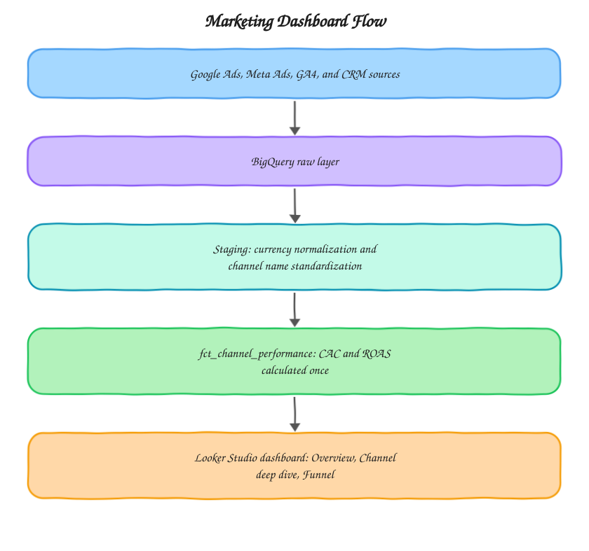

# Marketing Dashboard Toolkit

A framework for pulling spend, revenue, and channel performance into a single BigQuery model that feeds one dashboard, instead of five contradictory ones. Built around the kind of stack I set up at [motabar.builds.stuff](https://motabarbuildstuff.com/): ad platforms plus CRM plus GA4, blended into one source of truth.

## The problem this solves

Most marketing teams have their spend in Google Ads and Meta, their revenue in a CRM or Shopify, and their behavioral data in GA4, and none of the three agree with each other because each platform names channels differently, reports in different currencies, and attributes conversions on its own logic. This toolkit resolves all three into a single channel-level fact table so CAC, ROAS, and revenue by channel can finally be trusted, no matter which page of the dashboard someone is looking at.

## Architecture

The two staging steps are deliberately separated from the join logic. Currency normalization and channel name standardization ("cpc" in Google Ads vs "paid_search" in GA4) are the kind of small inconsistencies that silently break a join, so they're handled before `unified_spend_revenue.sql` ever runs, not inside it.

## What's in here

* `sql/unified_spend_revenue.sql` blends ad spend and CRM revenue into one channel and date level table, the query that normally lives in someone's head instead of the warehouse
* `dbt_models/fct_channel_performance.sql` the mart table the dashboard queries directly, with CAC and ROAS calculated once so no two pages can disagree
* `looker_studio/dashboard_spec.md` the page by page spec, including filters, scorecards, and refresh cadence, that I use when building the actual dashboard

## How it's used in practice

The raw layer lands each source as-is with minimal transformation, so nothing upstream ever depends on a fragile join. The staging layer handles the two things that break blended reporting most often: currency and naming inconsistency. The mart layer is the only place CAC and ROAS get calculated, and every dashboard page reads from it directly rather than recomputing anything, which is what keeps three different filtered views of the same dashboard from ever showing three different numbers for the same metric.

## What good output looks like

Once wired up, `fct_channel_performance` should have one row per date and channel with non-null `total_spend`, `total_revenue`, `cac`, and `roas`. A channel with spend but no CRM-attributed revenue will show `total_revenue = 0` rather than a null, which is intentional, a null there usually means a UTM tracking gap rather than genuinely zero revenue, and that's a separate audit finding (see `ga4-bigquery-audit-toolkit`).

## Setup

1. Set up API access for Google Ads, Meta Marketing API, and your CRM's API or export
2. Land raw data into `project.ads.*` and `project.crm.*` tables matching the schema referenced in `sql/unified_spend_revenue.sql`
3. Run the dbt project to build `fct_channel_performance`
4. Connect Looker Studio directly to the mart table and build pages per `looker_studio/dashboard_spec.md`

## Stack

BigQuery, dbt, Looker Studio, Google Ads API, Meta Marketing API

## Related

* Case study: [Single Source of Truth for Marketing Data](https://motabarbuildstuff.com/case-studies/single-source-of-truth-for-marketing-data/)
* Service: [Marketing analytics consulting](https://motabarbuildstuff.com/marketing-analytics-consultant/)

Built by [Motabar Javaid](https://motabarbuildstuff.com/about/), analytics engineer at [motabar.builds.stuff](https://motabarbuildstuff.com/).
