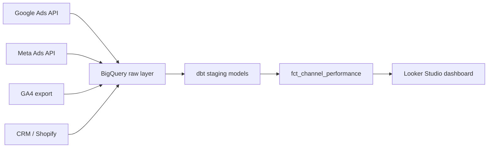

# Marketing Dashboard Toolkit

A framework for pulling spend, revenue, and channel performance into a single BigQuery model that feeds one dashboard, instead of five contradictory ones. Built around the kind of stack I set up at [motabar.builds.stuff](https://motabar.builds.stuff): ad platforms plus CRM plus GA4, blended into one source of truth.

## The problem this solves

Most marketing teams have their spend in Google Ads and Meta, their revenue in a CRM or Shopify, and their behavioral data in GA4, and none of the three agree with each other. This toolkit blends all three into a channel level fact table so CAC, ROAS, and revenue by channel can finally be trusted.

## Architecture

## What's in here

* `sql/unified_spend_revenue.sql` blends ad spend and CRM revenue into one channel level table
* `dbt_models/fct_channel_performance.sql` the mart table the dashboard queries directly, with CAC and ROAS calculated
* `looker_studio/dashboard_spec.md` the page by page spec I use when building the actual Looker Studio dashboard on top of this model

## How it's used in practice

The raw layer lands each source as-is with minimal transformation, so nothing upstream ever depends on a fragile join. The dbt layer handles currency normalization, channel name standardization (Google Ads calls it "cpc", GA4 calls it "paid_search"), and the actual spend to revenue join. Everything the dashboard shows comes from the single `fct_channel_performance` table, so there's one number for CAC no matter which page of the dashboard you're looking at.

## Stack

BigQuery, dbt, Looker Studio, Google Ads API, Meta Marketing API
